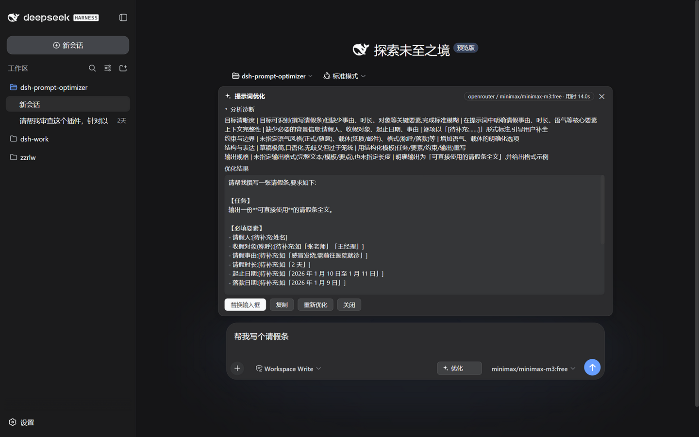
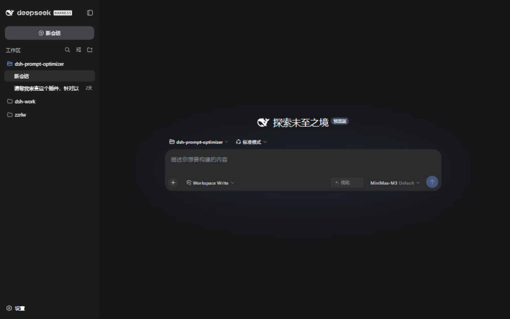
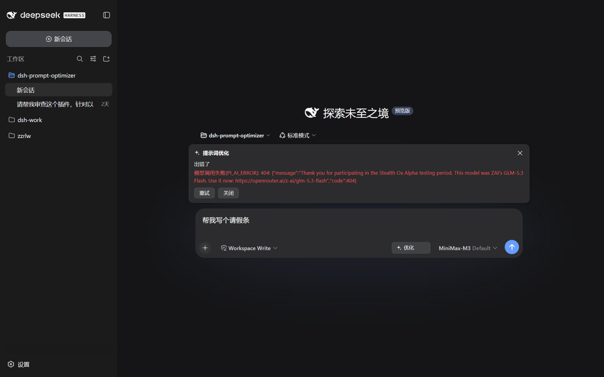
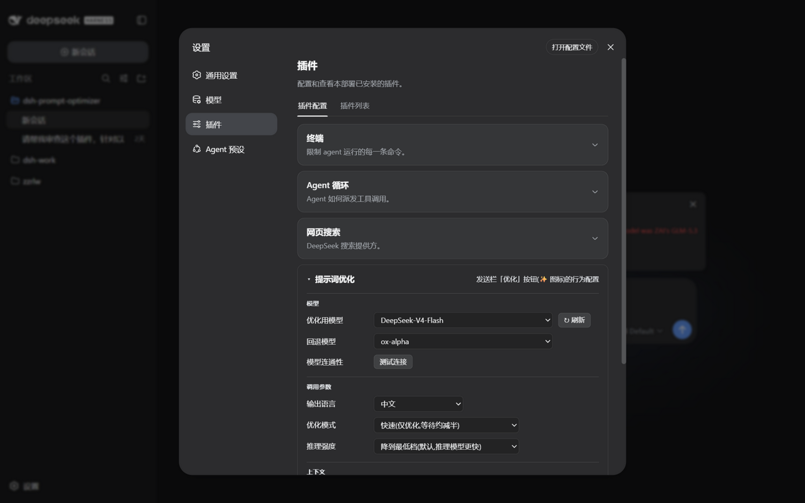

# dsh-prompt-optimizer

[中文](README.md) | **English** | 🐣 [Beginner guide (中文)](README.simple.md)

[](https://github.com/Y1X1n/dsh-prompt-optimizer/actions/workflows/ci.yml)
[](https://www.npmjs.com/package/@y1x1n/dsh-prompt-optimizer)
[](LICENSE)
[](https://github.com/Y1X1n/dsh-prompt-optimizer/releases/latest)
[](https://github.com/Y1X1n/dsh-prompt-optimizer/stargazers)
[](CONTRIBUTING.md)

A DeepSeek Harness plugin that adds an **Optimize** button (✨) next to the composer, one click analyzes and rewrites the prompt draft in your input box, with results **streamed section by section over SSE**. The optimization call reuses the current session's model route by default (read live on every click — switching models in the session takes effect immediately).

- **Host side**: registers two routes, `POST /dsh-prompt-optimizer/optimize` (SSE streaming) and `POST /dsh-prompt-optimizer/test-model` (connectivity probe), and drives `ctx.llm` for the "analyze + rewrite" call.
- **Client side**: injects the button into the `conversation.input.right` slot, the result panel into `conversation.input.dock` (a full-width row above the input card, same family as TodoDock — renders on the new-session screen too and never covers the input box), and a collapsible settings card into `settings.plugin.item`. UI copy follows the DSH interface language (中文 / English).

## Contents

- [Features](#features)
- [Installation](#installation)
  - [From npm (recommended, simplest)](#from-npm-recommended-simplest)
  - [From a Release (tarball, no build)](#from-a-release-tarball-no-build)
  - [From source (tarball)](#from-source-tarball)
  - [From GitHub](#from-github)
  - [Uninstall](#uninstall)
- [Compatibility](#compatibility)
- [FAQ](#faq)
- [Verification status](#verification-status)
- [How it works](#how-it-works)
- [Development](#development)
- [Security notes](#security-notes)
- [Contributors](#contributors)
- [License](#license)

> 🐣 **First time using dsh plugins?** See the [beginner guide](README.simple.md) (in Chinese): three steps to install, one click to use.



| | |
|---|---|
|  |  |
|  |  |

## Features

- An **Optimize** button on the right of the composer tool row (disabled while empty, breathing animation while working). During the wait the panel shows the live stage (waiting for model / analyzing / writing the rewrite) with an elapsed-seconds readout; on completion the model badge shows the total duration.
- Reads the current session's provider/model on every click; **analysis and rewrite stream onto the panel** above the input card — no staring at a spinner for the whole generation.
- **Dual optimization strategies**: with no conversation context (fresh session, or context disabled) it rewrites with a **structured template** (role / task / constraints / output format); with context it switches to **distill-intent + polish** — reads the recent conversation, keeps the draft's original framing instead of forcing a template, never re-asks what the context already answers, and never resurfaces **directions you already rejected** (the do-not-enter set).
- **Fidelity discipline** (inspired by Fishsb/dsh-prompt-enhancer): semantic-equivalence floor, traceability (inferences are marked "unless otherwise specified / by default"), a pre-output element-by-element **fidelity self-check** against drift, with the self-check explicitly outranking the length discipline (target under 500 characters for simple tasks; the rewrite IS the prompt — never restate the draft or add explanations — and a missing element is worse than verbosity), and few-shot examples to stabilize output style.
- **Lightweight memory chain**: edit our optimized text and click Optimize again, and the previous round's result rides along as a continuity reference (accepted decisions carry over, only your changes are worked on). Same-text retries, cross-session calls, and degraded (non-wellFormed) results never ride (degradation is only judged in full mode — fast mode always counts as compliant); the chain resets the moment you send or close the panel, and it follows the "include context" switch.
- **Rewrite first (0.5.0)**: full mode now emits the **optimized prompt first, diagnosis after** — the deliverable you care about streams in immediately and can be copied away mid-wait; combined with the new fast default (rewrite only), the click-to-usable wait for long drafts drops noticeably.
- **Slash-command safe**: input like `/goal help me …` optimizes only the body; the command prefix is re-attached on replace — the command word is never rewritten. A bare command with no body (just `/goal`) is rejected up front with a notice instead of being "optimized" into garbage.
- **Context aware**: by default carries the session's recent conversation as reference (**user messages are guaranteed a floor** — agentic sessions produce far more assistant step fragments than user input, and naive recency sampling would crowd out what you actually asked), capped at 8 turns / 1600 chars; the meta-prompt explicitly forbids answering or continuing the context. Empty sessions fall back to the template strategy. Can be disabled in the settings card.
- Result panel: **five-dimension diagnosis** (goal clarity / context / constraints / structure / output spec) + the **full optimized prompt**; actions: **replace the input box** (with **undo**, which auto-invalidates once you edit the replaced text) / copy / re-optimize / close. **The panel closes itself after you send the message or clear the input.**
- **Cancel keeps the content**: press Esc while optimizing and the panel freezes in a cancelled state showing everything generated so far — review it, hit "re-optimize" to continue, or close. In any other state Esc just closes the panel. A client-side **timeout watchdog** (settings timeout + 5s margin) turns a hung Host or black-holed network into an explicit timeout error instead of an endless spinner.
- Panels are session-scoped: switching sessions never leaks an old result into another session's view or input box.
- **Auto-follow scrolling while streaming**: the live view sticks to the bottom as content grows, pauses when you scroll up, and resumes when you return near the bottom.
- All panel styling uses official Harness design tokens (`--dsw-alias-*`); follows light/dark theme automatically.
- Long-draft friendly: the output cap rises with estimated input length by default (full mode ×2 / fast mode ×1.5, capped at 32768); on real truncation the partial result is still shown with a clear notice instead of disappearing.
- Format tolerance: marker variants (e.g. `<<< ANALYSIS >>>`) parse correctly; in full mode, outright non-compliant output degrades gracefully with a warning; in fast mode the result is a single section, so it always counts as compliant whether or not the model emits markers (no warning, memory chain unaffected) — friendly to third-party/free models that skip the marker format — their raw stream is previewed live, character by character, until a marker appears.
- Settings → Plugins → the "Prompt Optimizer" page (flat row layout in three groups: Model / Generation parameters / Context; every change can be reverted in one step via "Undo last change" at the bottom — an in-memory stack of the last 20; the GitHub repo link sits at the bottom right):
  - **Model**: optimization model (**follow the current session** (default), or pin one from the model catalog, provider/model dropdown with manual refresh) / fallback model (automatic failover when the primary route fails before producing anything — the panel badge shows "· fallback", hover to see why) / connectivity ("Test connection", 32-token / 20s capped probe showing the actual route and latency)
  - **Generation parameters**: output language (中文 / English); mode: **fast** (default, rewrite only, roughly half the output tokens) / full (analysis + rewrite); reasoning effort: clamp to lowest tier (default — dramatically shortens the pre-first-token stall on reasoning models) / follow session; max output tokens (default 8192), timeout (default 120s), temperature (default 0.2, hover for the rationale); auto output-cap toggle (default on)
  - **Context**: include-context toggle (default on): when off, only the draft itself is read — no session history

## Installation

Prerequisite: the `dsh` CLI (an environment where `npx @deepseek-ai/dsh web` works).

### From npm (recommended, simplest)

```sh
dsh plugin --profile web add @y1x1n/dsh-prompt-optimizer
```

### From a Release (tarball, no build)

Download `y1x1n-dsh-prompt-optimizer-<version>.tgz` from the [Releases page](https://github.com/Y1X1n/dsh-prompt-optimizer/releases/latest), then install the local file:

```sh
dsh plugin --profile web add ./y1x1n-dsh-prompt-optimizer-<version>.tgz
```

### From source (tarball)

```sh
cd dsh-prompt-optimizer
npm install --legacy-peer-deps   # the prepare hook builds lib/ automatically
npm pack                          # produces y1x1n-dsh-prompt-optimizer-<version>.tgz
dsh plugin --profile web add ./y1x1n-dsh-prompt-optimizer-<version>.tgz
```

Then (re)start `dsh web` and open the Web UI — the button appears next to the composer.

> **Windows note**: `dsh plugin add ./directory` goes through pnpm `link:`, which currently misparses the drive-letter colon as a protocol separator and produces a broken symlink (`node_modules/<pkg>` points nowhere), so the plugin never loads. Use the tarball form for local installs; the directory-link form works on macOS/Linux.

### From GitHub

```sh
dsh plugin --profile web add github:Y1X1n/dsh-prompt-optimizer
```

Git installs pull the source; this package self-builds at install time via its `prepare` script (only Node needed, no monorepo). pnpm ≥10 refuses to run build scripts on first install — add the package name to `allowBuilds` in that profile's `pnpm-workspace.yaml` as the terminal prompt suggests, then retry. Pinning a commit is recommended: `github:Y1X1n/dsh-prompt-optimizer#<sha>`.

### Uninstall

```sh
dsh plugin --profile web remove @y1x1n/dsh-prompt-optimizer
```

## Compatibility

> **This version (v0.6.3) targets DeepSeek Harness**:
>
> | dsh version | Optimize route / model calls | Settings page (incl. GitHub link) | Composer button / result panel | Session context |
> |---|---|---|---|---|
> | **0.2.1-rc.5 (Web + official desktop runtime)** | ✅ verified live (successful rewrite produced) | ✅ verified live (tab + settings card) | ✅ verified live | ✅ contract-verified |
> | **0.2.1-rc.3 (Web + official desktop runtime)** | ✅ verified live (route/SSE/error state) | ✅ verified live (tab + settings read/write) | ✅ verified live | ✅ contract-verified |
> | **0.2.1-rc.2 (Web + official desktop)** | ✅ artifact-verified | ✅ artifact-verified (incl. slot-registration fix) | ✅ artifact-verified | ✅ now available |
> | **0.2.0-rc.2 (Web + official desktop)** | ✅ verified | ✅ verified (volatile config + native-style settings card) | ✅ verified | ✅ |
> | **0.1.5-rc.2** | ✅ verified | ✅ verified | ✅ verified | degraded (no `ctx.sessions`) |
> | **0.1.5-rc.1** | ✅ verified | ✅ verified | ✅ verified | degraded (no `ctx.sessions`) |
> | **0.1.2-rc.1 / 0.1.2-alpha.5** | ✅ verified | ✅ verified | ✅ verified | degraded (no `ctx.sessions`) |
> | **0.1.1-rc.2 and below** (0.1.0-rc.7+) | ✅ verified | ✅ verified | ✅ verified | degraded (no `ctx.sessions`) |
>
> One build covers 0.1.0-rc.7 through 0.2.1; `package.json` now declares `engines.dsh: ">=0.1.0-rc.7 <0.3.0-0"`, enforced by the host at boot (prereleases included), explicitly excluding 0.3.x.
>
> **About "artifact-verified"**: v0.6.0's 0.2.1-rc.2 support was established by inspecting the **real runtime shipped in the app's own `app.asar`** item by item (slot declarations, `SlotCore` throw behavior, the `ctx.sessions` provider, `session/page` pagination semantics, the `ConfigFormSnapshot` shape, `engines.dsh` validation, the client baseline static-module table), backed by targeted regression tests; at that time the full UI flow was not clicked through in a live 0.2.1-rc.2 GUI (the local instance requires a launch token). **v0.6.2 upgrades 0.2.1-rc.3 support to a real end-to-end run**: a throwaway profile was booted with the official desktop app's bundled rc.3 runtime CLI and the released tgz installed; the composer "Optimize" button, the `settings.plugins.tab` tab and the settings card were confirmed in the live page, settings writes persisted into the profile patch, and an optimize request reached the Host route and returned the upstream error through SSE (the test account has zero balance, so the error state rather than a successful completion was verified). Item-by-item differences: [`docs/dsh-021-rc3-diff.md`](docs/dsh-021-rc3-diff.md). This annotation is maintained in every Release note from v0.3.15 onward, and earlier Release notes have been retroactively annotated.

- **v0.4.0 adapts dsh 0.2.0-rc.2** (2026-10-03, Windows, real-profile end-to-end): ① Settings migration — 0.2.0 removed the `settingsScope` service and the `settings.plugin.item` slot; settings are now auto-generated by the host from the plugin's Config schema. The plugin declares every Config field `.volatile()` (volatile fields update in place via reference cells — **editing settings no longer remounts the plugin**), the client reads/writes through `configForms`, and the settings card registers BOTH the 0.2.0 `settings.plugins.tab` and the 0.1.x `settings.plugin.item` slots — each host renders the one it knows. ② The settings card was redesigned to the 0.2.0 official design language (flat rows, native-style segmented controls and switches, `configure({auto:false})` hiding the host's duplicate auto form). ③ The `kind:'plugin'` message source crosses 0.2.0's narrowed union via a structural assertion (the runtime tolerates unknown sources, merge-extensible). ④ Verified on **0.2.0-rc.2 Web** (button, SSE panel, model-catalog RPC, settings read/write with profile-patch persistence and no plugin restart, undo) and the **official desktop app** (Electron `DeepSeek Harness 0.2.0-rc.2`, `desktop` profile installed via the app's own CLI, composer button and settings card verified through UIA).
- **Session id stamped on llm calls (v0.4.0, fixes opencode)**: opencode (`opencode-go`) requires the `x-opencode-session` per-conversation header, which the pi-ai adapter injects only when `GenerateOptions.sessionId` is present — the plugin's one-shot calls never set it, so the API rejected them over missing headers (opencode could not be probed or used to optimize). The client now sends the originating session id and the Host stamps it on the llm call (session-level metering attributes the call correctly); the connectivity probe stamps a fixed synthetic id. Other adapters treat sessionId as model-hidden transport metadata and never send it.
- **Session stamp always present (v0.5.0, hardens opencode)**: v0.4.0's stamp depended on the client sending a session id; on host forms that never deliver `sessionId` to slot components the request body lacked it and opencode still complained about the missing header. Since 0.5.0 the Host falls back to a synthetic id (`prompt-optimizer-one-shot`) whenever the client omits one (or sends whitespace), so every call path satisfies the header requirement; when the client does send the real id, metering attribution is unchanged. Note that profiles still running 0.3.x-or-older plugin builds do not include the fix — upgrade to 0.5.0+ and restart the host / refresh the page.
- **Official desktop installation**: after the desktop app initializes its `desktop` profile on first launch, fully quit the app, install with the app's own CLI and relaunch: `"E:\Deepseek-Harness\resources\runtime\cli\bin\dsh.cmd" plugin --profile desktop add @y1x1n/dsh-prompt-optimizer` (macOS/Linux paths per app install dir); do not manage the desktop's reserved profile with the npm CLI.
- Development baseline: `@deepseek-ai/*` **0.2.1-rc.5** (pinned by `sync:types`, same version in devDeps, from v0.6.3); previously 0.2.1-rc.3 (from v0.6.2), 0.2.1-rc.2 (from v0.6.0), 0.2.0-rc.2 (v0.4.0) and 0.1.5-rc.1 (v0.3.17), verified on **0.1.0-rc.8** (2026-08-20, Windows, real-profile install + Web routes / client bundle / session-history RPC / end-to-end LLM call), re-verified on **0.1.1-rc.2** (2026-08-27), and adapted + verified on **0.1.2-rc.1 / 0.1.2-alpha.5** (2026-09-05/06), on **0.1.5-rc.1** (2026-09-10, real-profile end-to-end smoke tests: composition layer, route SSE, client bundle, composer button and result panel, settings card), and on **0.1.5-rc.2** (2026-09-11, full-chain re-verification: composition-layer injection, Host load, route contract 405/400/200, end-to-end SSE with 155 delta frames, all four strategy paths, client bundle slots and settings-card API — all passing, 69 tests green). **0.2.1-rc.2** was adapted on 2026-10-18 (item-by-item inspection of the `app.asar` runtime; typecheck and four suites green; the full GUI flow was not clicked through). **0.2.1-rc.3** was adapted on 2026-10-26: all six upstream commits diffed (see [`docs/dsh-021-rc3-diff.md`](docs/dsh-021-rc3-diff.md)), the type baseline moved to rc.3, and a throwaway profile booted with the official desktop app's bundled rc.3 runtime was used for a **real Web end-to-end run** (composer button, result-panel error state, settings tab and settings-card read/write; a successful LLM completion was not verified because the test account has zero balance).
- Verified on **macOS** via automated tests (2026-09-02, macOS 26.5 (Darwin 25.5.0), Node.js v26.0.0; after `npm install --legacy-peer-deps`, `sync:types` / `typecheck` / `build` / `npm test` all pass — 62 tests green); CI now runs typecheck and the full suite on both ubuntu-latest and macos-latest (@ruijiaang-lab, #3).
- **dsh-settings API compatibility layer**: the 0.1.2 line rewrote the settings API (standalone `installSettingsSection` removed, replaced by the `installSection` method on the `ctx.settings` service instance). 0.3.16+ feature-detects at runtime: uses the new interface when present, otherwise an inline equivalent (register + watch + unload fallback); when the settings service is absent it falls back to the composition-layer config.
- **Client type surface migrated across 0.1.2/0.1.5** (adapted in v0.3.17): the `dsh-client-runtime` package is gone upstream, so `ClientContext` is simply cordis' `Context`; `SettingsScope` moved to `@deepseek-ai/dsh-client-ui-settings/client` (its `SettingsScopeBinder` now owns the `ctx.settingsScope` Context merge — re-declaring it would conflict); the `ctx.slots` merge is provided by `@deepseek-ai/dsh-client-ui-renderer/client`. `HistoryEntry` / `ModelProviderGroup` moved into the unpublished `dsh-api-session-controller`, so the plugin now ships its own minimal structural faces in `src/client/host-faces.ts` instead of chasing upstream types.
- **Session model & catalog (real since v0.3.17)**: the model catalog goes through the connection-level generic RPC `session/modelCatalog` (the `/api` channel; the payload envelope requires exactly one plain-object `args` field — `{ args: {} }` for a zero-parameter method); "follow the current session" reads the official per-session model directory service `ctx.modelDirectories` (provided by `dsh-client-ui-model-selection`, the same directory the /model popup uses, whose `current` is the model the session will actually use). That service is captured through a **separate optional inject** — folding it into the main inject would leave clients waiting forever on hosts without it; when absent the plugin falls back to Host route resolution.
- **Session history (context) now works on 0.2.x (fixed in v0.6.0)**: the legacy `connection.api.sessions.history` face was never implemented upstream (absent across 0.1.0-rc.7 → 0.2.1), so "carry recent conversation" silently degraded through v0.5.0. Since 0.2.0/0.2.1 the plugin reads the **session event window** instead: `ctx.sessions.binding(sessionId).eventSource` already holds the host-seeded tail page (`maxMessages:500`, at least 2 turns / 50 messages; `loadOlder()` pages further back) as `{type:'event', event}` entries, from which it extracts the last 4 real user messages plus 4 assistant replies. Note that the `session/page` RPC looks usable but requires the `throughSeq` upper bound from a follow opening frame — a cold call with `-1` makes `paginate()` compute `end=0` and return an empty page, so it is deliberately not used. The service is captured through its own **optional inject**, so 0.1.x hosts keep the old degradation ladder (event window → legacy query face → no context).
- **0.2.1-rc.5 adaptation notes (v0.6.3)**: rc.4/rc.5 are again purely additive — `src/` needs zero behavior changes. The four host surfaces the plugin relies on (both composer slots still `list`/`session`, the composer standard props, `settings.plugins.tab` in both types and runtime, and the still-absent legacy `settings.plugin.item`) are byte-identical to rc.3. The only real code changes land in `ui-chat` (thinking blocks gained `rawText`; the plugin occupies no `conversation.chat.*` slot and has zero type-graph references to it) and in the ui-conversation view-tab tooltips (the contract/facade/apply blobs are identical between the two versions). This release is declaration-only adaptation: the type baseline (the 19 `sync:types` packages plus devDeps) moved to 0.2.1-rc.5, `package-lock.json` was regenerated, and description/version/docs were updated; a real rc.5 Web run additionally produced a **successful rewrite** end to end (see below).
- **0.2.1-rc.3 adaptation notes (v0.6.2)**: rc.3 is purely additive for this plugin — `src/` needs zero behavior changes for a lossless upgrade. The surfaces the plugin relies on (`conversation.input.right` / `conversation.input.dock`, still `list` / `session`; `settings.plugins.tab`; the composer standard props `useInput` / `inputActions` / `sessionId`; `ui-slots` / `ConnectionHandle` / `dsh-llm` / `ConfigFormSnapshot` / `SessionSnapshot`; package-manifest validation; the client `staticModules` baseline) are byte-identical to rc.2; ui-conversation only added the More-menu slots and the `whenDraftExists` / `appendDraft` draft-initialization API, which the plugin does not go through. This release is declaration-only adaptation: the type baseline (`sync:types`' 19 packages plus the `dsh-client-ui-slots` / `dsh-llm` devDeps) moved to 0.2.1-rc.3, `package-lock.json` was regenerated, description/version/READMEs were updated, and `test/upstream-contract.test.mjs` now pins the baseline versions and the three slot contracts in CI. Upstream behavior notes: the official API-key route now follows the `/models` listing (the set can change with the account), the official models declare a 1M context window, and a pinned model that has disappeared from the catalog ends the call with a host error (visible in the panel's error state).
- **0.2.1-rc.2 adaptation notes (v0.6.0)**: ① The `settings.plugin.item` slot is gone from upstream (confirmed in both the runtime bundles and the npm package), and `SlotCore.register` **throws synchronously** for an undeclared slot while `slots.inject` re-throws callback failures through `queueMicrotask` as page-level uncaught errors — the old code registered `settings.plugins.tab` and `settings.plugin.item` inside one `slots.inject` callback, which on 0.2.1 registers the tab and then throws. Both slots are now registered under **separate injects**, so an undeclared one only skips itself (`test/slot-guard.test.mjs` pins this against the real `SlotCore`). ② `ConfigFormSnapshot` dropped `mode: 'host' | 'memory'` — in-memory mode no longer exists, so the settings card copy no longer mentions it and uses `settings.readOnly` instead. ③ `package.json` gained `dsh.manifestVersion: 1` and `engines.dsh`. ④ Type baseline pinned to `0.2.1-rc.2`.
- **Client slot props dual form**: since 0.1.2 the composer slots are session-scoped — components read session/draft state via standard hooks (`useInput`/`useSession`), and registration uses the official two-layer shape (register inside an inject callback on the derived context, with an `inject(sessionId)` hook). Components dispatch on the props shape (hooks on 0.1.2, direct snapshots on older hosts), so both hosts share one build.
- **Client bundle registration id**: the loader id in `lib/client.js` must equal the plugin npm package name (the host's client-modules validates registration against it); the client inject list no longer names `dsh-client-runtime`, which 0.1.2 merged away. From 0.1.5 the bundle is served through a combined `/plugins/??<id>/client.js,…&rev=<hash>` URL — bare per-plugin paths are no longer exposed (the boot manifest's combined URL is authoritative).
- Protocol contract: `/dsh-prompt-optimizer/optimize` returns 400/405/409/413 as plain JSON on pre-check failure and switches to an SSE stream on success (model errors arrive as `error` events); `/dsh-prompt-optimizer/test-model` **always returns HTTP 200** with an `ok` field in the body (a probe is application-level semantics, deliberately not mapped to transport status codes) — integrate against `ok`, not the status code.
- The HTTP carrier service name has drifted between releases (`httpServer` in the npm 0.0.1-rc.x type packages, `webServer` in the 0.1.0-rc.x runtime): the plugin waits on both names via `ctx.inject` with no static hard dependency — if the name changes again, only this plugin's routes fail to register (with a log warning after 10s); the Harness startup is never dragged down.
- Client and Host must be the same version (the SSE protocol is a private contract): after upgrading, restart `dsh web` and refresh the browser.

## FAQ

- **Clicked "Optimize" and nothing happened?** Open the browser console and look for logs starting with `[dsh-prompt-optimizer]`; common causes are no model configured (set up a provider under Settings → Models first), or the upstream slot the panel needs is not ready yet (refresh the page).
- **"No usable model found"?** The session has no routable model selected and no model is pinned in the settings card; fix either one. You can also expand the settings card and hit "Test connection" to confirm the route works.
- **The settings card says the model catalog failed to load?** Since v0.3.17 the catalog goes through the host's `session/modelCatalog` RPC and should list every provider and model; if it still fails, the notice includes the concrete reason (hit "Refresh" to retry). Note that "follow the session" depends on the host's per-session model directory service (`ctx.modelDirectories`); on host forms without it, optimization falls back to the Host's first available route (a matching Console warning appears).
- **Result truncated?** The panel shows a truncation notice; the auto output cap (on by default) already rises with draft length — if it is still not enough, raise "Max output tokens" in the settings card.
- **Session model change not taking effect?** Every click re-queries the session's current model; if it still looks wrong, check the console for a `session model query failed` warning (the first available route is used as a fallback then). Note: a model pinned in the settings card overrides the session selection.
- **Occasional timeout / RATE_LIMIT failures on optimization?** Transient-error retries are handled by the host at the **provider layer** (dsh 0.1.1+ provider config ships a retry policy covering `RATE_LIMIT / SERVER / TIMEOUT / TRANSPORT / EMPTY_RESPONSE` by default). Tune retry count and backoff under Settings → Models → the provider in question — not the plugin's "timeout" setting, which only bounds a single call's total duration.
- **opencode (opencode-go) models still complain about a missing header?** You need plugin ≥0.5.0 on a 0.2.x host (the pi-ai adapter injects `x-opencode-session` only from `GenerateOptions.sessionId`). Check the installed plugin version in the profile (`dsh plugin --profile <profile> list`), upgrade, then restart the host / refresh the page; on host forms that never deliver a session id to slot components, 0.5.0+ stamps a synthetic id Host-side and no longer depends on the client carrying one.
- **Can't find the card on the settings page?** 0.3.0's strict enum schema could clash with older settings documents and stop the card from rendering; fixed in 0.3.1 (unknown enum values fall back to defaults). Make sure you are on ≥0.3.1 and refresh.
- **Button still there after uninstall?** Plugin-set changes only take effect after restarting `dsh web`; a page refresh is not enough.

## Verification status

**v0.6.3 was verified end-to-end on a real 0.2.1-rc.5 Web UI** (2026-10-31, Windows, an independent profile booted with the official desktop app bundled rc.5 runtime CLI, driven by headless Chrome/CDP): the Host log shows `[dsh-prompt-optimizer] loaded`; the composer "Optimize" button starts disabled and becomes enabled once a draft is typed; clicking it streams the output and **produces a successful rewrite in ~6-7s**, with the panel offering "Replace input / Copy / Re-optimize / Close" and the badge reading `magpie / trae-cn/deepseek-v4.1-flash-max · 5.9s` (the other run took 7.0s); the Settings → Built-in plugins → "Prompt optimizer" tab and the full settings card render, with the model dropdown listing the whole host catalog; the browser console recorded zero errors. **v0.6.2 was verified end-to-end on a real 0.2.1-rc.3 Web UI** (2026-10-26, Windows, throwaway profile booted with the official desktop app's bundled rc.3 runtime CLI, browser-driven): after installing the released tgz, the Host log showed `[dsh-prompt-optimizer] loaded` and the routes were registered; the composer "Optimize" button appeared with input and carried this plugin's style class; clicking it opened the result panel and the request went through the Host route and SSE, returning the upstream error (`QUOTA: Insufficient Balance` — the test account has zero balance, so this verified the error state and the pass-through path); the "Built-in plugins → Prompt optimizer" tab and settings card rendered fully, and switching the output language persisted into the profile's `cordis.patch.yml`. Verified in a real environment (dsh 0.1.0-rc.8 tested + 0.1.1-rc.2 re-verified, Windows — see Compatibility); macOS automated verification passed (2026-09-02, macOS 26.5, all 62 tests green, and CI now permanently runs the full suite on macos-latest); **v0.3.16 completed end-to-end verification on the 0.1.2 line** (dsh 0.1.2-rc.1 / 0.1.2-alpha.5: composer button, result panel, settings card, optimize route and SSE); **v0.3.17 completed end-to-end verification on 0.1.5-rc.1** (2026-09-10, Windows, real profile + browser-driven: the composer「Optimize」button enables with input, the panel opens on click and passes the upstream error through SSE, and the settings card shows both the collapsed summary and the full controls), **and a full-chain re-verification on 0.1.5-rc.2** (2026-09-11: composition-layer injection, Host load, route contract, end-to-end SSE, all four strategy paths, client bundle slots and settings-card API — every item passing); v0.3.9–0.3.11 were additionally verified end-to-end on a **third-party free model** (openrouter `minimax/minimax-m3:free`, which emits no marker format): both strategies, element-by-element fidelity, `[TODO]` markers, memory chain, and cancel-keeps-content all behave as designed — and this live testing is what surfaced the fast-mode false-positive fixed in v0.3.10/11.

- Composition-layer load: `--dump-config` shows the `# == @y1x1n/dsh-prompt-optimizer` layer;
- Host: startup log `[dsh-prompt-optimizer] loaded`; both routes behave correctly across their 400/405/409/413 paths; SSE streaming verified live;
- Client: the bundle is picked up by client-modules and listed in the page boot manifest (from 0.1.5 served through the combined `/plugins/??<ids>&rev=<hash>` URL), with the plugin row present in the module list;
- End to end: a real `ctx.llm` call completes "analysis + rewrite" with correct marker parsing (`wellFormed: true`). **The v0.6.3 rc.5 re-run produced a successful rewrite** (`provider: magpie`, `model: group/safely-deepseek`, `wellFormed: true`, `truncated: false`); the v0.6.2 rc.3 re-run verified only the upstream error state and panel pass-through because the test account had zero balance.
- Automated tests (`npm test`, 99 cases):
  - `test/smoke.mjs`: 35 Host smoke cases (real cordis Context + mocked services: route-resolution priority, empty/malformed config, 400/405/409/413, non-object JSON body rejection, SSE event flow, post-header errors not escaping the route, concurrency cap 429, carrier service mounted exactly once, max-tokens truncation, timeout, fast mode and the new default, reasoning clamp (by intensity rank, not display order), legacy-settings normalization, connectivity test, session-stamp fallback, fallback chain with fallback-reason passthrough, tool-calls guard, auto output cap, context injection and hard switch, strategy selection, memory-chain injection and truncation, origin fence);
  - `test/prompt.test.mjs`: 25 meta-prompt parsing cases (marker whitespace variants, degradation paths, empty OPTIMIZED segment not falling back to raw text, marker text never entering the result, unclosed think blocks not polluting parsing, partial-stream parsing, both output orders, stream-buffer compaction (single-segment and two-stage), CJK token-estimation coverage, context payload and budgeting, strategy fork, fidelity rules and examples, memory-chain payload);
  - `test/controller.test.mjs`: 29 client pure-logic cases (SSE frame parsing with corrupt-frame skipping, frame coalescing, interrupted connections, session-query skipping, undo flow, retry preserving the slash prefix, close-abort, cancel keeping partial output plus its state gate, client timeout watchdog, history extraction filtering and degradation, slash-prefix splitting and bare-command rejection, memory-chain passing and gates, send-to-close decisions, duration recording, user-first context sampling, live preview and compaction fallback under the new output order);
  - `test/slot-guard.test.mjs`: 5 slot-guard cases (`s1–s4` pin the "undeclared slot throws + separate inject guards" boundary against the real upstream `SlotCore`; `s5` loads the real `lib/client.js` and calls the real `apply()`);
  - `test/upstream-contract.test.mjs`: 5 upstream-contract cases (new in v0.6.2: baseline package versions match the pins, both composer slots stay list/session, the composer standard props are still declared, `settings.plugins.tab` stays declared in both types and runtime, and the legacy `settings.plugin.item` is still absent).

## How it works

```
Click "Optimize"
  → Client reads the input draft + the session's model selection (session.models RPC, queried
    live on every click; skipped when a model is pinned in settings — the Host's pinned value wins)
  → POST /dsh-prompt-optimizer/optimize { text, sessionId, provider, model, reasoningEffort, context?, previous? }
    (sessionId = originating session id, stamped onto the llm call by the Host; the Host
     falls back to a synthetic id when absent. previous = the memory chain: the previous
     round's result, carried when you re-optimize an edited rewrite)
  → Host calls ctx.llm.stream() with the system meta-prompt
    (route resolution: pinned setting → session selection → first available route; an optional
     fallback route fails over on zero-output failure; the output cap rises with estimated input
     tokens by default; optional reasoning clamp / low temperature)
  → text-delta chunks are pushed over SSE and the panel shows "rewrite / analysis" sections live
    (incrementally parsed on <<<OPTIMIZED>>> / <<<ANALYSIS>>> markers in either order,
     whitespace variants tolerated; since 0.5.0 the rewrite streams first in full mode)
  → the done event carries the final parsed result; a max-tokens finish carries a truncated flag; a fallback adds its reason
  → one click replaces the input box (undoable, slash prefix re-attached) / copy / re-optimize (edits continue from the previous result; same text regenerates fresh)
  → Esc while optimizing = cancel (a cancelled state keeps what was generated); a client-side watchdog guards against an unresponsive Host
```

## Development

```sh
npm install --legacy-peer-deps   # install deps and trigger the build
npm run sync:types               # sync the client type packages (see below)
npm run typecheck                # tsc --noEmit
npm run build                    # produces lib/{index,client,prompt,controller}.js
npm test                         # smoke + prompt + controller + slot-guard + upstream-contract suites
```

### About `sync:types`

The upstream monorepo publishes only part of the `@deepseek-ai/*` packages (the rest are `publishConfig: restricted`), so the client type packages' transitive dependencies cannot be installed from npm. `scripts/sync-types.mjs` handles it:

1. Published packages are `npm pack`ed and extracted straight into `node_modules` (bypassing npm's dependency-tree resolution);
2. For unpublished packages (e.g. `dsh-type-meta`), it scans every `.d.ts` reference and generates minimal stub packages (only module resolvability matters under `skipLibCheck`).

These packages only participate in type checking; at runtime everything is provided by the Harness page/process (`react` and `@deepseek-ai/*` are external).

### Directory layout

```
dsh-prompt-optimizer/
├── package.json          # dsh.bundle + dsh.client dual manifest
├── cordis.patch.yml      # composition layer: inserts the Host plugin line
├── src/
│   ├── index.ts          # Host plugin: settings namespace + two HTTP routes + llm call (with fallback chain)
│   ├── prompt.ts         # meta-prompts, marker parsing, token estimation (pure functions)
│   └── client/
│       ├── index.tsx     # Client entry: slot registrations
│       ├── controller.ts # shared state machine for button/panel + SSE consumption (standalone artifact, unit-testable)
│       ├── i18n.ts       # zh/en UI copy, follows the DSH interface language
│       ├── OptimizeButton.tsx   # composer button
│       ├── ResultDock.tsx       # result panel above the input card (live streaming + undo)
│       ├── SettingsCard.tsx     # settings page (Model / Params / Context row groups)
│       ├── SparkleIcon.tsx      # hand-drawn ✨ icon
│       └── GitHubIcon.tsx       # GitHub icon (repo link at the bottom of the settings page)
├── scripts/build.mjs     # esbuild: Host ESM + Client lazy-CJS factory + two test artifacts
├── scripts/sync-types.mjs
├── scripts/prompt-probe.mjs  # prompt evidence probe: fires real optimize requests at a running instance (PROBE_ROUTE=provider/model to pin a route)
└── test/                 # smoke.mjs (Host) / prompt.test.mjs / controller.test.mjs
```

## Security notes

- The HTTP routes are registered on dsh's own web server, which listens on `127.0.0.1` by default. If you expose dsh to your LAN (`0.0.0.0`), this plugin's optimize endpoint becomes callable from the LAN too — it consumes your configured model quota; be aware.
- Both routes enforce an **origin fence**: requests carrying an `Origin` header (browser POSTs always do) must match `Host`, and `Host` must be a loopback address or the machine's actual local address — cross-site forged requests (CSRF) and DNS rebinding get a 403; command-line calls without `Origin` are unaffected.
- The plugin holds no API keys: every model call goes through the Harness-configured `ctx.llm` routes.

## Contributors

Thanks to the following contributors for improvements to this project (see the [contributing guide](CONTRIBUTING.md)):

- [@ruijiaang-lab](https://github.com/ruijiaang-lab) — contributing guide ([#2](https://github.com/Y1X1n/dsh-prompt-optimizer/pull/2))

## License

MIT
