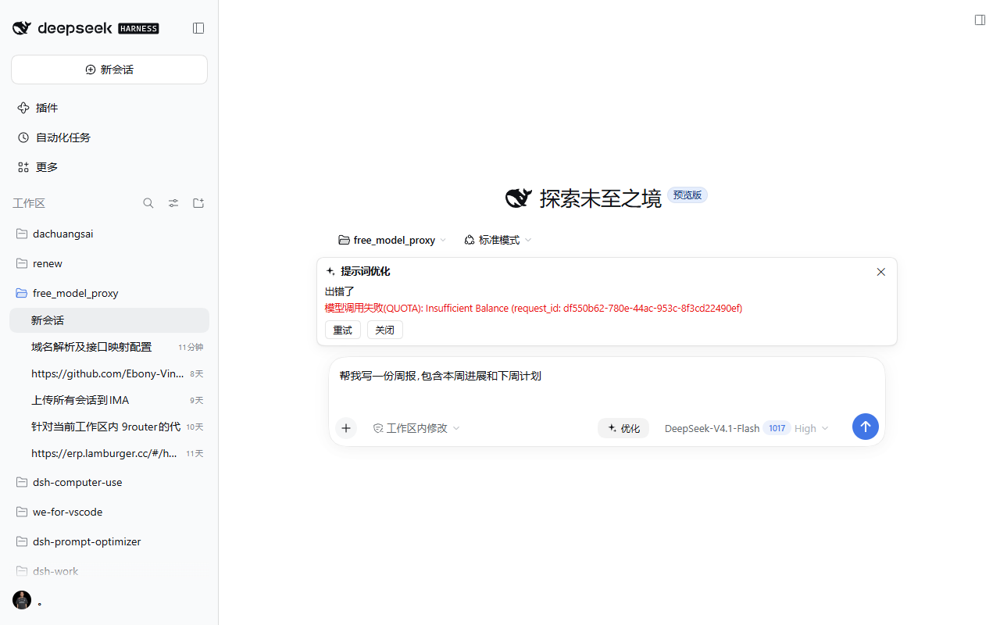

# v0.6.2 — 适配 dsh 0.2.1-rc.3(上游差异核查 + 类型基线升级 + 真实端到端验证)

本版针对 DeepSeek Harness **0.2.1-rc.3** 做版本适配。调研方式:逐 commit 对读上游 `deepseek-harness` 的 `dsh-v0.2.1-rc.2...dsh-v0.2.1-rc.3` 源码,把 npm 上 `@deepseek-ai/*` 两版 tarball 与桌面端 `app.asar` 随包的 rc.3 运行时逐项核对;完整记录见 [`dsh-021-rc3-diff.md`](dsh-021-rc3-diff.md)。

**结论先行**:0.2.1-rc.3 对本插件是**纯加法上游,`src/` 零行为改动即可无损升级**(`tsc --noEmit` 在 rc.3 全量类型下 0 错误)。本版只做**声明层适配**(类型基线、lock、描述/文档/版本),并新增一条上游契约守卫测试;另外首次在**真实 rc.3 Web 页面**上完成端到端验证。

## 上游变化(rc.2 → rc.3,6 个 commit)

| commit | 内容 | 对本插件 |
|---|---|---|
| `5ff29190` | 新增左侧栏 / 会话视图 / 右侧栏的「更多」菜单与导航入口自定义;ui-conversation 草稿初始化扩展 | 新槽位与新 API,**不改插件已用契约** |
| `67516495` | 导航入口 / 预设选择的 analytics 埋点 | 无关 |
| `39d29038` | 修复:pin 与选中分离、菜单图标 | 无关 |
| `c48f8523` | DeepSeek API-key 路由跟随官方 `/models` 列表 | 类型零变化;模型集合改为动态(见下) |
| `d02ea370` / `1f81c047` | release: 全部包版本号 0.2.1-rc.2 → rc.3 | 类型基线需要跟进 |

与插件直接相关的核对结论(逐字节 / 行号级证据见差异文档):

- `conversation.input.right` / `conversation.input.dock` 仍声明为 `kind:'list'` / `scope:'session'`,composer 标准 props(`useInput` / `inputActions` / `sessionId`)未变;
- `settings.plugins.tab` 契约与运行时实现逐字节不变;0.1.x legacy 的 `settings.plugin.item` 在 rc.3 的 npm 包与桌面端 client bundle 中仍为 **0 命中**(既有独立 `inject` 守卫继续正确);
- `ui-slots`(`SlotMap` / `SlotEntryDef` / `PropsRuntime`)、`ConnectionHandle` / `rpc.call`、`dsh-llm`、`ConfigFormSnapshot`、`SessionSnapshot`、包清单校验、client `staticModules` 基线均与 rc.2 逐字节相同;
- 桌面端 `app.asar` 内全部 `@deepseek-ai/*` 包版本 = 0.2.1-rc.3,与 npm 发布版仅构建路径 / CSS 哈希盐差异。

## 本版改动

### 类型基线与声明

- `scripts/sync-types.mjs` 里 19 个钉版本包全部升到 `0.2.1-rc.3`;
- `devDependencies` 的 `@deepseek-ai/dsh-client-ui-slots` / `@deepseek-ai/dsh-llm` 升到 `0.2.1-rc.3`;
- `package-lock.json` 重新生成(此前仍锁 rc.2,CI 的 `npm ci` 会装回旧基线);
- `package.json` 版本 `0.6.2`、描述改为适配 rc.3(`engines.dsh` 区间与 `manifestVersion` 不变,继续覆盖 0.1.0-rc.7 → 0.2.x)。

### 新增:上游契约守卫测试

新增 `test/upstream-contract.test.mjs`(5 项),在 CI 里锁定:

1. 已安装钉版包版本 == `sync-types` 钉版(防止旧 `node_modules` 让 typecheck 悄悄跑在旧基线上);
2. `conversation.input.right` / `conversation.input.dock` 仍为 `list` / `session`;
3. composer 标准 props `useInput` / `inputActions` / `sessionId` 仍在;
4. `settings.plugins.tab` 类型与运行时声明仍在;
5. legacy `settings.plugin.item` 仍不存在。

下一轮上游升级若动了这些面,CI 会直接指出来,而不是等到线上静默降级。

## 验证

### 真实 0.2.1-rc.3 Web 端到端(v0.6.2 新增)

2026-10-26,Windows,使用**官方桌面端自带的 rc.3 runtime CLI**(`E:\DSH\resources\runtime\cli\bin\dsh.cmd`,`--version` = `0.2.1-rc.3`)引导一个临时 profile。验证分两段,避免把 0.6.1 的行为记到 0.6.2 头上:

1. 先用 0.6.1 的构建跑通链路(按钮 / 面板 / 设置读写),确认 rc.3 宿主本身可用;
2. 再以**本版最终 tgz(0.6.2)** 重装并复验:详情页显示 v0.6.2 / 来源 `...0.6.2.tgz` / 运行中,发送栏「优化」按钮与设置标签页、设置卡正常,并**再次双向切换输出语言**——写入分别落到 profile 的 `cordis.patch.yml`(`language: en` @ 15:19:33,`language: zh` @ 15:19:58),证明 `configForms` 读写与持久化在 0.6.2 × rc.3 上正常。

- Host:启动日志 `[dsh-prompt-optimizer] loaded, POST /dsh-prompt-optimizer/optimize`,路由注册成功;宿主没有报 manifest / engines 版本不兼容;
- Client:发送栏出现带 `.dsh-po-btn.dsh-po-opt` 类的「优化」按钮;输入草稿后按钮可用;
- 结果面板:点击「优化」后面板打开,请求经 Host 路由与 SSE 返回上游错误:

  ```
  模型调用失败(QUOTA): Insufficient Balance (request_id: df550b62-780e-44ac-953c-8f3cd22490ef)
  ```

  测试账户余额为 0,因此验证的是**错误态与透传链路**而非「优化成功」;成功输出沿用此前版本(0.1.x/0.2.0 线)的实测。
- 设置页:设置 → 内置插件 → 「提示词优化」标签页出现,设置卡完整渲染(模型 / 回退模型 / 调用参数 / 上下文等);输出语言写入见上。



### 静态 / 自动化

- `npm run typecheck`:零错误(rc.3 全量类型)
- `npm run build`:成功
- `npm test`:**五套 / 99 项全绿**
  - `smoke` 35 项(Host 半)
  - `prompt` 25 项
  - `controller` 29 项
  - `slot-guard` 5 项
  - `upstream-contract` 5 项(本版新增)
- CI 等价检查:在干净目录用本仓库 `package.json` + `package-lock.json` 执行 `npm ci --legacy-peer-deps` 通过(随后 `sync:types` / `typecheck` / `test` 与 CI 同序)。

## 上游行为变化提示(不影响兼容,但值得知道)

- **官方 API-key 路由的模型列表改为跟随 `/models`**:模型集合可能随账号 / 时间变化。若在设置卡里固定了一个已从目录下线的模型,优化调用会以宿主错误结束(结果面板 error 态可见);把「优化用模型」改回「跟随当前会话」或重新选择即可。
- **DeepSeek 官方模型上下文窗口标注为 1M**(`1_048_576`),本插件的「输出上限自适应」不受影响。
- **新会话草稿保留**:rc.3 修复了切换会话后点击「新会话」丢草稿的问题;插件使用的 `inputActions.setDraft` 语义未变。

## 兼容性

| dsh 版本 | 优化路由 / 模型调用 | 设置页 | 发送栏 / 面板 | 会话上下文 |
|---|---|---|---|---|
| **0.2.1-rc.3**(Web + 官方桌面端运行时) | ✅ 实测(路由/SSE/错误态) | ✅ 实测 | ✅ 实测 | ✅ 契约核对 |
| **0.2.1-rc.2** | ✅ | ✅ | ✅ | ✅ |
| **0.2.0-rc.2** | ✅ | ✅ | ✅ | ✅ |
| 0.1.5-rc.2 / 0.1.5-rc.1 | ✅ | ✅ | ✅ | 降级 |
| 0.1.2-rc.1 / 0.1.2-alpha.5 | ✅ | ✅ | ✅ | 降级 |
| 0.1.1-rc.2 及以下(0.1.0-rc.7+) | ✅ | ✅ | ✅ | 降级 |
| ≥ 0.3.0 | — | — | — | `engines.dsh` 拒绝安装(显式放弃) |

> 本版与 0.6.1 是**同一份构建形态**,`src/` 无行为改动;仍建议所有 0.2.1-rc.3 用户升级到本版,以拿到 rc.3 类型基线校验与新增的契约守卫。

## 升级

```sh
dsh plugin --profile web add ./y1x1n-dsh-prompt-optimizer-0.6.2.tgz
```

**官方桌面端**:先完全退出应用,用应用自带 CLI 安装后重启:

```sh
"E:\DSH\resources\runtime\cli\bin\dsh.cmd" plugin --profile desktop add ./y1x1n-dsh-prompt-optimizer-0.6.2.tgz
```

升级后重启宿主并刷新页面(建议 Ctrl+F5 强刷)。
