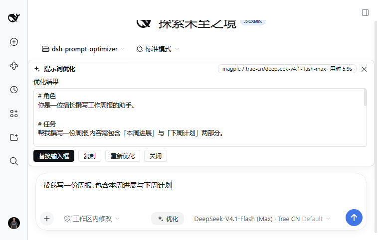

# v0.6.3 — 适配 dsh 0.2.1-rc.5(上游差异核查 + 类型基线升级 + 真实成功输出端到端验证)

本版针对 DeepSeek Harness **0.2.1-rc.5** 做版本适配(rc.3 之后跨 rc.4 / rc.5 两版)。调研方式:逐 commit 对读上游 `deepseek-harness` 的 `dsh-v0.2.1-rc.3...dsh-v0.2.1-rc.5`(13 个 commit),把 npm 上 `@deepseek-ai/*` 两版 tarball 逐文件 SHA-256 对读,并与桌面端 `app.asar` 随包的 rc.5 运行时交叉核对;完整记录见 [`dsh-021-rc5-diff.md`](dsh-021-rc5-diff.md)。

**结论先行**:0.2.1-rc.5 对本插件仍是**纯加法上游,`src/` 零行为改动即可无损升级**(`tsc --noEmit` 在 rc.5 全量类型下 0 错误)。本版只做**声明层适配**(类型基线、lock、描述/文档/版本),并在**真实 rc.5 Web 页面**上完成一次**成功产出优化稿**的端到端验证(rc.3 轮因测试账户余额为 0 只到错误态)。

## 上游变化(rc.3 → rc.5,13 个 commit)

| commit | 内容 | 对本插件 |
|---|---|---|
| `534dac8c` | fix(web): 思考块渲染自定义 —— 只改 `packages/client/ui-chat`:新增 `reasoning-text.ts` 剥 `<signature>`,槽位 `conversation.chat.reasoning.body` 的 owner props **新增必填 `rawText`**、`text` 语义改为「已处理的展示文本」 | **无影响**:插件不占用任何 `conversation.chat.*` 槽位,类型图 0 引用 ui-chat,结果面板自绘 |
| `c38265a0` / `72624bae` | fix(ui): view tab tooltip 仅在标签溢出时显示(按 88px 格宽估算字宽) | 仅 `skeleton/ConversationSession.tsx` 内部;契约/标准 props 不变 |
| `199ffe37` | fix(ui): More views tooltip 固定定位 | 同上,并删除 locale key `session.moreViewsCurrent` |
| `41736cde` / `940aafca` / `cb7f0878` / `cc4446ee` | fix(acp|mcp): 诊断输出不污染 stdout | 无关(仅 CLI/ACP 侧日志路由) |
| `504a01a9` / `31cfe2aa` | release(dsh): 0.2.1-rc.4 / 0.2.1-rc.5 版本号批量 bump | 类型基线需要跟进 |

官方 release notes 要点:rc.4 = 修复 ACP 模式诊断输出混入 stdout;rc.5 = 优化对话中思考内容的展示效果。

与插件直接相关的核对结论(逐字节 / 行号级证据见差异文档):

- `conversation.input.right` / `conversation.input.dock` 仍为 `kind:'list'` / `scope:'session'`,composer 标准 props(`useInput` / `inputActions` / `sessionId`)未变;
- `settings.plugins.tab` 类型与运行时实现逐字节不变;0.1.x legacy 的 `settings.plugin.item` 在 rc.5 的 npm 包与桌面端 asar 中仍为 **0 命中**;
- `ui-slots`、`ConnectionHandle`、`dsh-llm`、`dsh-session`、`dsh-session-projection`、`dsh-tools`、`dsh-api-session-controller`、`dsh-package-manifest`、`dsh-app-boot` 全部与 rc.3 **逐字节相同**;
- npm 46 个包逐文件 SHA-256:38 SAME / 7 DIFF,其中 4 个仅版本号或日志级别字符串变化(真实代码变化只落在 `ui-conversation` 的 tooltip 与 `ui-chat` 的思考块);
- 桌面端 `app.asar` 内 302/313 个 `@deepseek-ai/*` 为 rc.5;client `staticModules` 基线与 rc.3 是**同一 bundle SHA-256**,仍含 react / react/jsx-runtime。

## 本版改动

### 类型基线与声明

- `scripts/sync-types.mjs` 里 19 个钉版本包全部升到 `0.2.1-rc.5`;
- `devDependencies` 的 `@deepseek-ai/dsh-client-ui-slots` / `@deepseek-ai/dsh-llm` 升到 `0.2.1-rc.5`;
- `package-lock.json` 重新生成(此前仍锁 rc.3,CI 的 `npm ci` 会装回旧基线);
- `package.json` 版本 `0.6.3`、描述改为适配 rc.5(`engines.dsh` 区间与 `manifestVersion` 不变,继续覆盖 0.1.0-rc.7 → 0.2.x)。

### 契约守卫

`test/upstream-contract.test.mjs` 无需改动即可在 rc.5 基线上通过——它按 `sync-types` 的钉版表遍历校验已装版本、并断言三个槽位契约,天然跟随基线升级。

## 验证

### 真实 0.2.1-rc.5 Web 端到端(本版新增,首次验证到「成功输出」)

2026-10-31,Windows,使用**官方桌面端自带的 rc.5 runtime CLI**(`E:\DSH\resources\runtime\cli\bin\dsh.cmd`,`--version` = `0.2.1-rc.5`)引导一个独立 profile(`po-rc5-test`),安装本版 tgz 后启动 Web,并用无头 Chrome(CDP)真实驱动页面:

- Host:启动日志 `[dsh-prompt-optimizer] loaded, POST /dsh-prompt-optimizer/optimize`;宿主未报 manifest / engines 不兼容;
- 发送栏:出现带 `.dsh-po-btn.dsh-po-opt` 类的「优化」按钮,空草稿时 disabled;在编辑器键入草稿后**自动变为 enabled**;
- 优化面板:点击按钮 → 面板打开 → 流式输出 → 约 7.0s 后**成功产出优化稿**,面板出现「替换输入框 / 复制 / 重新优化 / 关闭」,徽章显示 `magpie / trae-cn/deepseek-v4.1-flash-max · 用时 7.0s`;
- 设置页:设置 → 内置插件 → 「提示词优化」标签页正常出现,设置卡完整渲染,模型下拉列出宿主全部目录(含 routing group 与 NVIDIA NIM 等分组);
- 全程浏览器控制台**零错误**(Runtime.exceptionThrown / console.error / log.error 均无记录)。



### 静态 / 自动化

- `npm run typecheck`:零错误(rc.5 全量类型)
- `npm run build`:成功
- `npm test`:**五套 / 99 项全绿**
  - `smoke` 35 项(Host 半)
  - `prompt` 25 项
  - `controller` 29 项
  - `slot-guard` 5 项
  - `upstream-contract` 5 项
- 干净目录 `npm ci --legacy-peer-deps` 通过(lock 可用)
- CI:ubuntu-latest / macos-latest 双绿

## 上游行为提示(不影响兼容)

- **思考块渲染**(rc.5):Chat 侧新增「已处理展示文本 + rawText」双字段,只影响自定义思考块渲染扩展;本插件结果面板自绘,不受影响。
- **会话视图 tooltip**(rc.4):标签未溢出时不再显示 tooltip,属于上游 UI 打磨,插件无感。

## 兼容性

| dsh 版本 | 优化路由 / 模型调用 | 设置页 | 发送栏 / 面板 | 会话上下文 |
|---|---|---|---|---|
| **0.2.1-rc.5**(Web + 官方桌面端运行时) | ✅ 实测(成功产出优化稿) | ✅ 实测 | ✅ 实测 | ✅ 契约核对 |
| **0.2.1-rc.3** | ✅ 实测 | ✅ 实测 | ✅ 实测 | ✅ 契约核对 |
| **0.2.1-rc.2** | ✅ | ✅ | ✅ | ✅ |
| **0.2.0-rc.2** | ✅ | ✅ | ✅ | ✅ |
| 0.1.5-rc.2 / 0.1.5-rc.1 | ✅ | ✅ | ✅ | 降级 |
| 0.1.2-rc.1 / 0.1.2-alpha.5 | ✅ | ✅ | ✅ | 降级 |
| 0.1.1-rc.2 及以下(0.1.0-rc.7+) | ✅ | ✅ | ✅ | 降级 |
| ≥ 0.3.0 | — | — | — | `engines.dsh` 拒绝安装(显式放弃) |

> 本版与 0.6.2 是同一份构建形态,`src/` 无行为改动;建议所有 0.2.1-rc.5 用户升级到本版以拿到 rc.5 类型基线校验。

## 升级

```sh
dsh plugin --profile web add ./y1x1n-dsh-prompt-optimizer-0.6.3.tgz
```

**官方桌面端**:先完全退出应用,用应用自带 CLI 安装后重启:

```sh
"E:\DSH\resources\runtime\cli\bin\dsh.cmd" plugin --profile desktop add ./y1x1n-dsh-prompt-optimizer-0.6.3.tgz
```

升级后重启宿主并刷新页面(建议 Ctrl+F5 强刷)。
