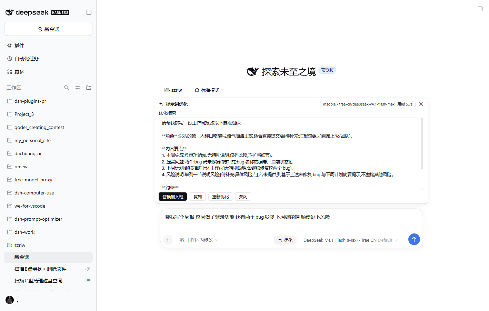
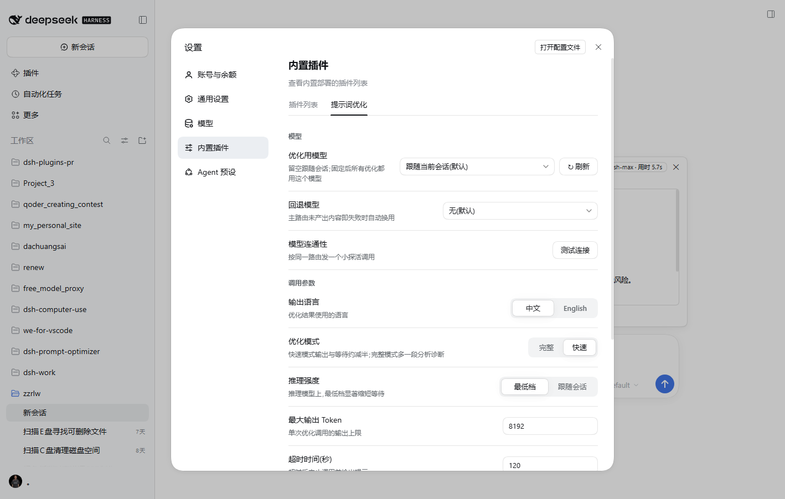

# v0.6.4 — 适配 dsh 0.2.2-rc.1(上游契约核查 + 发送阶段接入 + 真实成功输出端到端验证)

**结论先行**:0.2.2-rc.1 对本插件是**平台契约不变 + 交互语义增强**的一次升级。插件依赖的三个槽位(`conversation.input.right` / `conversation.input.dock` / `settings.plugins.tab`)、composer 标准 props、`InputActions.setDraft` / `InputState.draft`、`ui-slots` / `ui-renderer` / `dsh-llm` 公开面全部保持;本版只做**一处行为适配**(把「发送即关闭」接入 0.2.2 新增的 `phase:'sending'`)与声明层适配(类型基线、lock、版本/文档),并在真实 rc.1 Web 上完成成功产出优化稿的端到端验证。

## 变更

### 适配

- **发送阶段接入**:0.2.2 起宿主在确认接收前保留草稿,发送期间输入框只读,`InputState.phase` 新增 `'sending'`。结果面板现在读取该字段,点击发送即关闭(不再等草稿清空/running 翻转);旧宿主无该字段,行为保持原样。优化进行中仍不自动关闭。
- **依赖版本线**:`@deepseek-ai/cordis` devDep 升到 `^4.1.0`(上游 vendor 从 4.0.5 升到 4.1.0),`@deepseek-ai/schemastery` 运行时依赖升到 `^3.19.0`。
- **类型基线**:`sync:types` 的 19 个上游包与 devDeps(`dsh-client-ui-slots` / `dsh-llm`)钉到 `0.2.2-rc.1`,`package-lock.json` 重新生成。
- **上游契约守卫**:新增 `u3b`,锁定 `setDraft`、`InputState.draft` 与 `phase:'sending'` 仍在基线里。

### 上游差异核查(详见 [docs/dsh-022-rc1-diff.md](dsh-022-rc1-diff.md))

- 槽位声明块与 rc.5 **逐字节相同**;composer 标准 props / `SessionStandardProps` 块逐字节相同。
- `ui-slots` 全部 `.d.ts` 与 `lib/index.js` 相同;`ui-renderer` 客户端类型相同;`dsh-llm` 公开方法面相同。
- 桌面端 `staticModules` 基线完全相同(react / react/jsx-runtime / react-dom / cordis / zod / ……),插件 bundle 外部依赖未变。
- 真实代码变化集中在发送语义、引用/附件交互、设置导航图标(新可选槽位)、cordis/schemastery 版本线与大量加法功能;插件不占用相关新槽位。
- `session/page` RPC 被 `session/events` 取代,插件实际使用的 `session/modelCatalog` 与 `ctx.sessions.binding().eventSource.entries` 均保持。

## 验证

### 真实 0.2.2-rc.1 Web 端到端

2026-11-11,Windows,官方桌面端自带的 rc.1 runtime CLI(`E:\DSH\resources\runtime\cli\bin\dsh.cmd`,`--version` = `0.2.2-rc.1`)新建独立 profile `po-rc1-test`,安装本版 tgz 后启动 Web,用无头 Chrome(CDP)真实驱动:

- Host 日志 `[dsh-prompt-optimizer] loaded`;无 manifest / engines 警告;
- 发送栏「优化」按钮空草稿 disabled,键入草稿后 enabled;点击后流式输出,**两次实测 13.4s / 5.7s 成功产出优化稿**(`magpie / trae-cn/deepseek-v4.1-flash-max · 用时 5.7s`);
- 「替换输入框 / 撤回」路径正常;设置 → 内置插件 → 「提示词优化」标签页与设置卡完整渲染,模型下拉列出宿主全部目录;输出语言切换写入 profile `cordis.patch.yml`;
- 浏览器控制台零 error、零未捕获异常。





### 静态 / 自动化

- `npm run typecheck`:零错误(0.2.2-rc.1 全量类型)
- `npm run build`:成功
- `npm test`:**5 套 / 100 项全绿**
  - `smoke` 35 项(Host 半)
  - `prompt` 25 项
  - `controller` 29 项(新增 `sending` 阶段断言)
  - `slot-guard` 5 项
  - `upstream-contract` 6 项(新增 `u3b`)

## 兼容性

| dsh 版本 | 优化路由 / 模型调用 | 设置页 | 发送栏 / 面板 | 会话上下文 |
|---|---|---|---|---|
| **0.2.2-rc.1**(Web + 官方桌面端运行时) | ✅ 实测(成功产出优化稿) | ✅ 实测 | ✅ 实测 | ✅ 契约核对 |
| **0.2.1-rc.5 / rc.3 / rc.2** | ✅ 实测 | ✅ 实测 | ✅ 实测 | ✅ 契约核对 |
| **0.2.0-rc.2** | ✅ | ✅ | ✅ | ✅ |
| 0.1.5 / 0.1.2 / 0.1.1 / 0.1.0-rc.7+ | ✅ | ✅ | ✅ | 降级 |
| ≥ 0.3.0 | — | — | — | `engines.dsh` 拒绝安装(显式放弃) |

> 0.1.x 宿主没有 `phase` 字段,发送即关闭继续按草稿清空 / `running` / 队列判定,无行为变化。

## 升级

```sh
dsh plugin --profile web add ./y1x1n-dsh-prompt-optimizer-0.6.4.tgz
```

**官方桌面端**:先完全退出应用,用应用自带 CLI 安装后重启:

```sh
"E:\DSH\resources\runtime\cli\bin\dsh.cmd" plugin --profile desktop add ./y1x1n-dsh-prompt-optimizer-0.6.4.tgz
```

升级后重启宿主并刷新页面(建议 Ctrl+F5 强刷)。