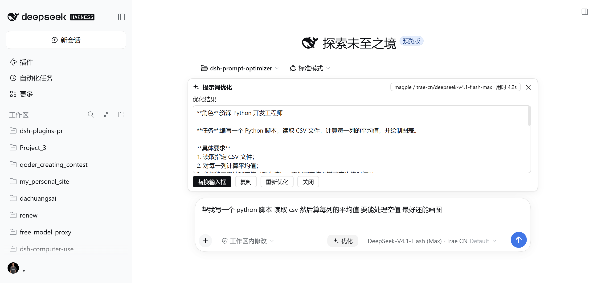
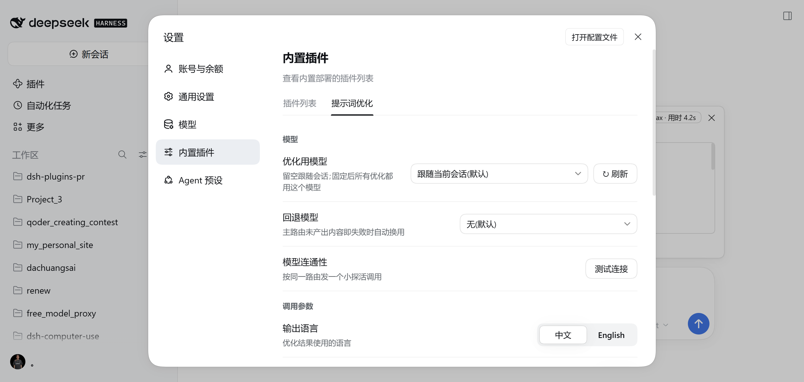

# v0.6.5 — 适配 dsh 0.2.2-rc.3(上游契约核查 + 类型基线升级 + 真实成功输出端到端验证)

**结论先行**:0.2.2-rc.3 对本插件是**平台契约完全不变 + 上游功能加法**的一次升级。插件依赖的三个槽位(`conversation.input.right` / `conversation.input.dock` / `settings.plugins.tab`)、composer 标准 props、`InputActions.setDraft` / `InputState.draft` / `InputState.phase`(含 `'sending'`)、`session/modelCatalog` RPC 与事件窗口、桌面端 `staticModules` 基线全部保持;**`src/` 零改动**,本版只做声明层适配(类型基线、lock、版本/文档),并在真实 rc.3 Web 上完成两次成功产出优化稿的端到端验证。

## 变更

### 适配

- **类型基线**:`sync:types` 包表从 19 扩为 **20**(新增 `@deepseek-ai/dsh-error`——rc.2 起 `HarnessError` 基类从 dsh-llm 拆进该新包,dsh-llm / dsh-attachment 改为从它导入并再导出),全部钉到 `0.2.2-rc.3`;devDeps(`dsh-client-ui-slots` / `dsh-llm`)同版本,`package-lock.json` 重新生成。
- **依赖版本线不变**:上游 vendor 仍是 `cordis 4.1.0` / `schemastery 3.19.0`,插件的 `^4.1.0` / `^3.19.0` 无需再升。
- **代码零改动**:rc.2 的新功能(hoc 槽位、文档级粘贴路由、引用摘要、失败重试「继续生成」、菜单定位重构)与 rc.3 的新功能(实验性 DeepSeek 会话导入插件)均不经过插件依赖的面;LLM 错误分类收紧(`LlmError` 构造改为内置码)不影响插件——插件只读流式 `finish` 块的失败码/消息,从不构造 `LlmError`。

### 上游差异核查(详见 [docs/dsh-022-rc3-diff.md](dsh-022-rc3-diff.md))

- 23 个 npm 包 rc.1 / rc.3 双组 tarball 逐文件字节比对;三个槽位声明块与 `SessionStandardProps` 块**逐字节相同**(块哈希与 rc.5 时代一致)。
- `setDraft` / `draft` / `phase:'sending'` 逐字不变;`modelCatalog` RPC、`binding().eventSource.entries` 仍在;legacy `settings.plugin.item` 仍 0 命中。
- 桌面端 `staticModules` 基线完全相同;`window.__ModuleLoader__.load` 包装形态不变(connection bundle 仅压缩重建);runtime 树移入 app.asar 的 `dsh/node_modules`(338 包,328 个 rc.3),CLI 用法不变。
- 真实代码变化集中在:hoc 槽位 kind、composer 粘贴路由/重试注入、`insertQuote` 摘要参数、LLM 错误分类拆包、会话批量追加与历史自动加载(内部重构)、ui-primitives 菜单定位与 Markdown 增强;插件均不消费。

## 验证

### 真实 0.2.2-rc.3 Web 端到端

2026-11-16,Windows,官方桌面端自带的 rc.3 runtime CLI(`E:\DSH\resources\runtime\cli\bin\dsh.cmd`,`--version` = `0.2.2-rc.3`)引导独立 profile `po-rc3-test`,安装本版 tgz 后启动 Web,用无头 Chrome(CDP)真实驱动:

- Host 日志 `[dsh-prompt-optimizer] loaded`;无 manifest / engines 警告;
- 发送栏「优化」按钮空草稿 disabled,键入草稿后 enabled;点击后流式输出,**两次实测 4.2s / 5.3s 成功产出优化稿**(徽章 `magpie / trae-cn/deepseek-v4.1-flash-max · 用时 4.2s`,所附截图为首次运行);
- 「替换输入框 → 撤回」路径正常(替换后草稿为优化稿、面板显示「已替换 ✓」,撤回恢复原文);设置 → 内置插件 → 「提示词优化」标签页与设置卡完整渲染,模型下拉列出宿主全部目录;输出语言 zh → en → zh 切换均写入 profile `cordis.patch.yml`;
- 浏览器控制台零 error、零未捕获异常(仅两条新会话无历史的预期降级 warn)。





### 静态 / 自动化

- `npm run typecheck`:零错误(0.2.2-rc.3 全量类型)
- `npm run build`:成功
- `npm test`:**5 套 / 100 项全绿**
  - `smoke` 35 项(Host 半)
  - `prompt` 25 项
  - `controller` 29 项
  - `slot-guard` 5 项
  - `upstream-contract` 6 项(钉版一致性按 20 包校验)

## 兼容性

| dsh 版本 | 优化路由 / 模型调用 | 设置页 | 发送栏 / 面板 | 会话上下文 |
|---|---|---|---|---|
| **0.2.2-rc.3**(Web + 官方桌面端运行时) | ✅ 实测(成功产出优化稿) | ✅ 实测 | ✅ 实测 | ✅ 契约核对 |
| **0.2.2-rc.1** | ✅ 实测(v0.6.4) | ✅ 实测 | ✅ 实测 | ✅ 契约核对 |
| **0.2.1-rc.5 / 0.2.1-rc.3** | ✅ 实测 | ✅ 实测 | ✅ 实测 | ✅ 契约核对 |
| **0.2.1-rc.2** | ✅ 产物核对 | ✅ 产物核对 | ✅ 产物核对 | ✅ 契约核对 |
| **0.2.0-rc.2** | ✅ | ✅ | ✅ | ✅ |
| 0.1.5 / 0.1.2 / 0.1.1 / 0.1.0-rc.7+ | ✅ | ✅ | ✅ | 降级 |
| ≥ 0.3.0 | — | — | — | `engines.dsh` 拒绝安装(显式放弃) |

> 0.2.2-rc.2 未单独实测:rc.3 的契约核对完整覆盖 rc.2 引入的全部面向面变化,且 rc.2 → rc.3 上游仅新增会话导入插件与桌面更新修复。0.1.x 宿主的 `phase` 不含 `'sending'`,发送即关闭继续按草稿清空 / `running` / 队列判定,无行为变化。

## 升级

```sh
dsh plugin --profile web add ./y1x1n-dsh-prompt-optimizer-0.6.5.tgz
```

**官方桌面端**:先完全退出应用,用应用自带 CLI 安装后重启:

```sh
"E:\DSH\resources\runtime\cli\bin\dsh.cmd" plugin --profile desktop add ./y1x1n-dsh-prompt-optimizer-0.6.5.tgz
```

升级后重启宿主并刷新页面(建议 Ctrl+F5 强刷)。
