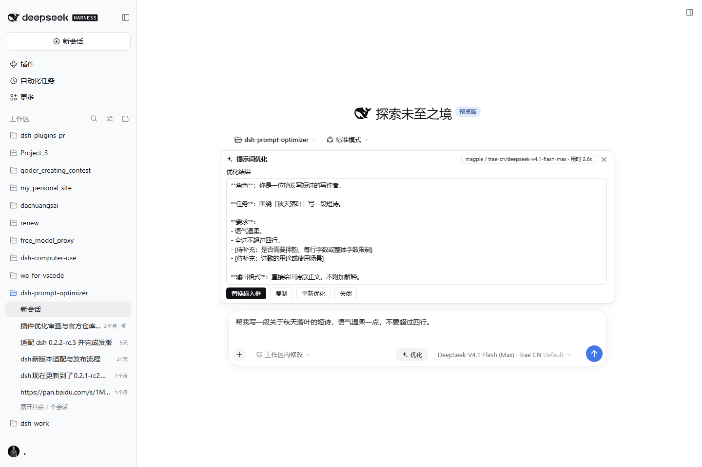
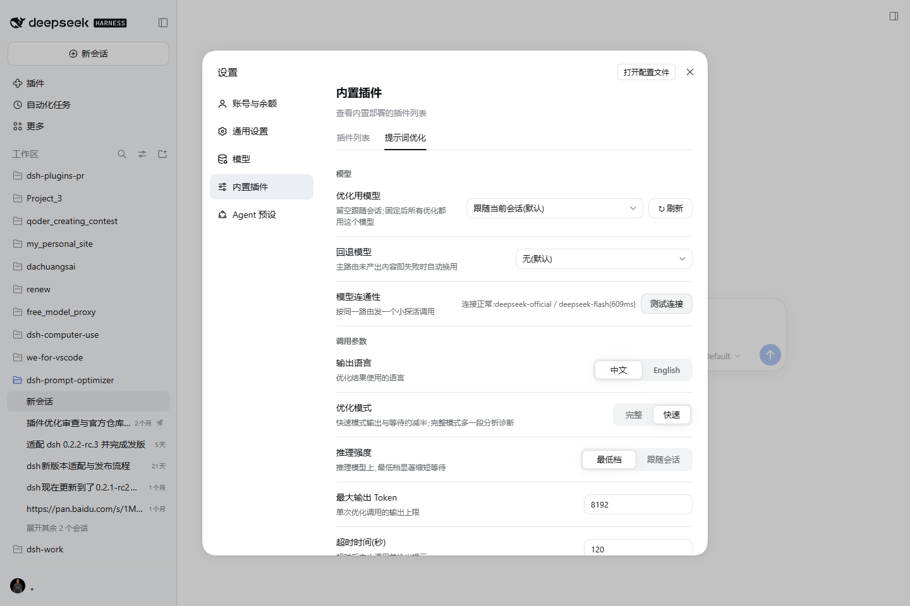

# v0.6.6 — 适配 dsh 0.2.2-rc.5(上游契约核查 + 类型基线升级 + 真实成功输出端到端验证)

**结论先行**:0.2.2-rc.5 对本插件是**平台契约完全不变 + 上游功能修复**的一次升级。插件依赖的三个槽位(`conversation.input.right` / `conversation.input.dock` / `settings.plugins.tab`)、composer 标准 props、`InputActions.setDraft` / `InputState.draft` / `InputState.phase`(含 `'sending'`)、`session/modelCatalog` RPC 与事件窗口、桌面端 `staticModules` 基线全部保持;**`src/` 零改动**,本版只做声明层适配(类型基线、lock、版本/文档),并在真实 rc.5 Web 上完成一次成功产出优化稿的端到端验证。

## 变更

### 适配

- **类型基线**:`sync:types` 的 20 个包全部钉到 `0.2.2-rc.5`;devDeps(`dsh-client-ui-slots` / `dsh-llm`)同版本,`package-lock.json` 重新生成。
- **依赖版本线不变**:上游 vendor 仍是 `cordis 4.1.0` / `schemastery 3.19.0` / `zod 4.6.6`,插件的 `^4.1.0` / `^3.19.0` 无需再升。
- **代码零改动**:rc.4 的 LLM 内容安全审查收敛为「拒绝时抛出 `LlmError(..., 'CONTENT_REFUSED')`」,并新增同名失败码;插件只读流式结果、从不构造 `LlmError`,该异常会沿既有错误路径进入 SSE `error` 事件(未产生 delta 时仍走既有回退链),无需新增分支。rc.4 的 LiveShare 桌面修复、rc.5 的 Web Search 默认提供方调整均不在插件依赖图内。

### 上游差异核查(详见 [docs/dsh-022-rc5-diff.md](dsh-022-rc5-diff.md))

- rc.3 → rc.5 共 **13 个 commit**;27 个 npm 包 rc.3 / rc.5 双组 tarball 逐文件字节比对。
- 三个槽位声明块与 `SessionStandardProps` 块**逐字节相同**(四个块哈希与 rc.5 时代一致);`setDraft` / `draft` / `phase:'sending'` 逐字不变;`modelCatalog` RPC、`binding().eventSource.entries` 仍在;legacy `settings.plugin.item` 仍 0 命中。
- 20 个钉版包中 19 个的 `lib/` 产物逐文件字节相同;`dsh-api-remotes` 仅一处生成代码 source line 注解位移(归一化后相同);devDep `dsh-llm` 的唯一类型变化是新增失败码 `CONTENT_REFUSED`(加法)。
- 桌面端 `staticModules` 基线完全相同(11 个模块),`dsh-web-frontend` 的 `dist/` 逐字节相同;`dsh-client-connection` 除版本号外无字节变化,ModuleLoader 包装形态不变。
- 真实代码变化集中在:DeepSeek 内容安全拒绝处理、LiveShare 桌面 tunnel worker、Web Search 默认提供方(DeepSeek 模型走服务端搜索);插件均不消费。

## 验证

### 真实 0.2.2-rc.5 Web 端到端

2026-11-21,Windows,用 npm 发布的 rc.5 CLI(`@deepseek-ai/dsh@0.2.2-rc.5`,`--version` = `0.2.2-rc.5`)引导全新 profile `po-022-rc5-test`,安装本版 tgz 后启动 Web,无头 Edge(Playwright/CDP)真实驱动:

- Host 日志 `[dsh-prompt-optimizer] loaded`;无 manifest / engines 警告;
- 发送栏「优化」按钮空草稿 disabled,键入草稿后 enabled;点击后流式输出,**2.6s 成功产出优化稿**(徽章 `magpie / trae-cn/deepseek-v4.1-flash-max · 用时 2.6s`);
- 「替换输入框 → 撤回」路径正常(替换后草稿为优化稿、面板显示「已替换 ✓」,撤回恢复原文 29 字符);
- 设置 → 内置插件 → 「提示词优化」标签页与设置卡完整渲染,模型下拉列出宿主全部目录;「测试连接」返回 `连接正常:deepseek-official / deepseek-flash(609ms)`;输出语言 zh → en → zh 切换均写入 profile `cordis.patch.yml`;
- 浏览器控制台零 error、零未捕获异常(仅两条新会话无历史的预期降级 warn)。





### 静态 / 自动化

- `npm run typecheck`:零错误(0.2.2-rc.5 全量类型)
- `npm run build`:成功
- `npm test`:**5 套 / 100 项全绿**
  - `smoke` 35 项(Host 半)
  - `prompt` 25 项
  - `controller` 29 项
  - `slot-guard` 5 项
  - `upstream-contract` 6 项(钉版一致性按 20 包校验)

## 兼容性

| dsh 版本 | 优化路由 / 模型调用 | 设置页 | 发送栏 / 面板 | 会话上下文 |
|---|---|---|---|---|
| **0.2.2-rc.5**(Web + rc.5 CLI) | ✅ 实测(成功产出优化稿) | ✅ 实测(标签页 + 设置卡读写 + 连接测试) | ✅ 实测 | ✅ 契约核对 |
| **0.2.2-rc.3** | ✅ 实测(v0.6.5) | ✅ 实测 | ✅ 实测 | ✅ 契约核对 |
| **0.2.2-rc.1** | ✅ 实测(v0.6.4) | ✅ 实测 | ✅ 实测 | ✅ 契约核对 |
| **0.2.1-rc.5 / 0.2.1-rc.3** | ✅ 实测 | ✅ 实测 | ✅ 实测 | ✅ 契约核对 |
| **0.2.1-rc.2** | ✅ 产物核对 | ✅ 产物核对 | ✅ 产物核对 | ✅ 契约核对 |
| **0.2.0-rc.2** | ✅ | ✅ | ✅ | ✅ |
| 0.1.5 / 0.1.2 / 0.1.1 / 0.1.0-rc.7+ | ✅ | ✅ | ✅ | 降级 |
| ≥ 0.3.0 | — | — | — | `engines.dsh` 拒绝安装(显式放弃) |

> 0.2.2-rc.4 未单独实测:rc.5 的 tarball 与真实 Web 验证完整覆盖 rc.4 引入的全部面向面变化(LLM 拒绝码、LiveShare 修复),且 rc.4 → rc.5 上游仅新增 Web Search 默认提供方调整。0.1.x 宿主的 `phase` 不含 `'sending'`,发送即关闭继续按草稿清空 / `running` / 队列判定,无行为变化。

## 升级

```sh
dsh plugin --profile web add ./y1x1n-dsh-prompt-optimizer-0.6.6.tgz
```

**官方桌面端**:先完全退出应用,用应用自带 CLI 安装后重启:

```sh
"E:\DSH\resources\runtime\cli\bin\dsh.cmd" plugin --profile desktop add ./y1x1n-dsh-prompt-optimizer-0.6.6.tgz
```

升级后重启宿主并刷新页面(建议 Ctrl+F5 强刷)。
